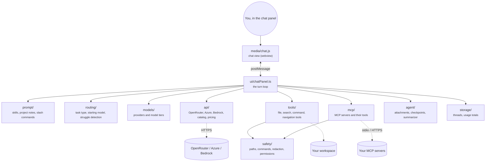

# Architecture

How Rizo is put together, for contributors. Paths are relative to
`vscode-extension/`.

## How a message flows

One turn, step by step:

1. `chatPanel.ts` receives the message from the webview and loads the
   thread from `storage/threadStore.ts`.
2. `prompt/skillsLoader.ts` picks the base skill plus up to two
   specialist skills by keyword, and `prompt/projectInstructions.ts` adds
   `.rizo/instructions.md` if the user approved that version.
3. On a chat's first message, `routing/complexityEstimator.ts` may start
   it on a stronger model of the same provider.
4. The model is called through `api/` (streaming for OpenRouter and
   Azure). Rizo's tools, plus MCP tools outside Plan mode, are offered.
5. Each tool call is shown as a card, approved where needed, and run by
   `tools/tools.ts` or `mcp/mcpManager.ts`. File writes are snapshotted
   first by `agent/checkpoints.ts` so the reply can be undone.
6. The loop repeats until the model answers without a tool call or the
   user presses Stop. Usage is recorded in `storage/usageStore.ts`, and
   `routing/struggleDetector.ts` decides whether to offer a retry on a
   stronger model.

## Modules

| Folder | What it owns |
|---|---|
| `src/extension.ts` | Activation: commands, keybinding targets, CodeLens, autocomplete provider |
| `src/ui/` | The chat panel host, webview HTML, trust prompts (folders, project notes), Azure and Bedrock connect flows, TODO CodeLens |
| `media/` | The chat view itself: `chat.html`, `chat.css`, `chat.js` (strict CSP, nonce scripts) |
| `src/agent/` | Attachments, folder mentions, checkpoints and undo, turn tracking, history summarizing |
| `src/api/` | OpenRouter streaming client, Azure v1 client, Bedrock Converse client, live model catalog, pricing |
| `src/models/` | The 10 OpenRouter providers and their model tiers, free-model fallback chains |
| `src/routing/` | Coding vs general task type, starting model and effort, struggle detection |
| `src/prompt/` | Skills loader and keywords, project instructions, slash commands |
| `src/tools/` | Tool definitions and execution, file search, plan checklist |
| `src/mcp/` | MCP protocol helpers, stdio and HTTP client, server manager and approvals |
| `src/editor/` | Inline edit and autocomplete |
| `src/safety/` | Path policy, command parsing and destructive-command detection, environment filtering, output redaction, dangerous-pattern scan, permission rules |
| `src/storage/` | Threads and usage totals in VS Code storage |
| `skills/` | Bundled engineering guidance in Markdown |

## Design rules

- **Pure logic has no `vscode` import.** Anything that can be tested
  without the editor (parsing, policies, prompts, protocol code) lives in
  its own module with a `*.test.ts` next to it. Modules that need the
  editor are tested through `test/vscodeStub.ts` where practical.
- **Security checks live in `safety/`** and are called from every place
  that needs them, so there is one implementation of each rule.
- **The webview is untrusted UI.** It only sends intents; the extension
  validates every message (thread ids, models, paths) before acting.
- **No new runtime dependencies without a reason.** The MCP client, the
  Bedrock client and the shell tokenizer are written in-house to keep the
  supply chain small.
